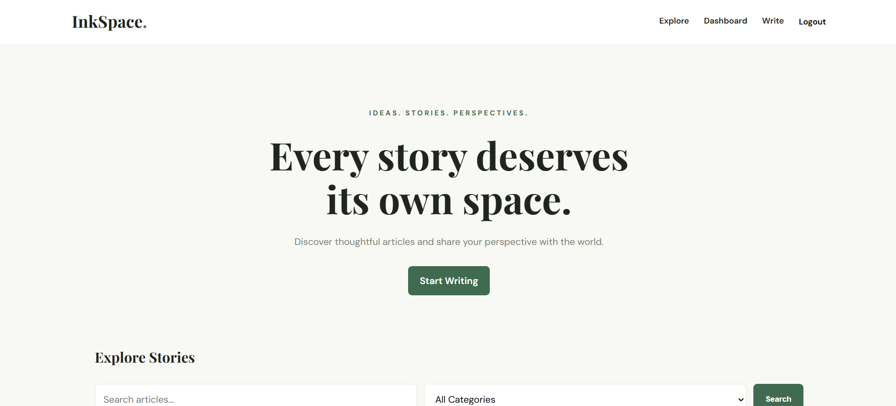
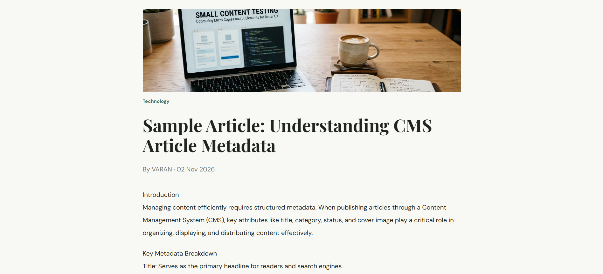
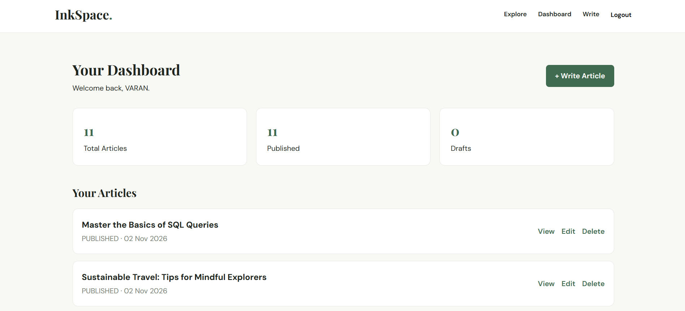
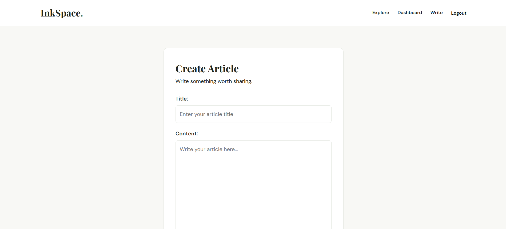
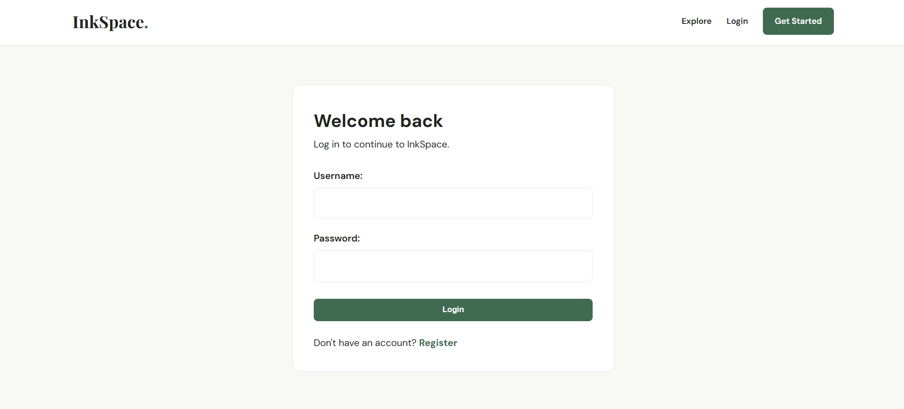
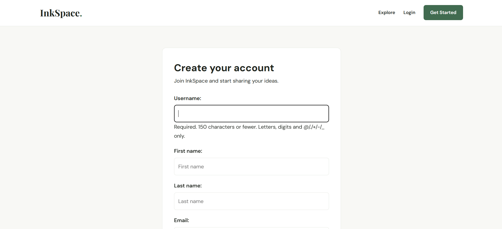

# InkSpace — Personal Blogging Platform

InkSpace is a Django-based personal blogging platform where users can create, manage, publish, and explore articles through a clean and simple interface.

The platform includes user authentication, article management, category-based browsing, search, pagination, and moderated comments.

## Features

- **User Authentication** — User registration and login.
- **Article Management** — Create, edit, delete, and manage articles.
- **Draft & Publish** — Save articles as drafts or publish them.
- **Categories** — Organize articles by category.
- **Search & Filtering** — Find articles and filter by category.
- **Comments** — Allow readers to comment on articles.
- **Comment Moderation** — Comments require approval before appearing publicly.
- **Dashboard** — Manage your articles from one place.
- **Pagination** — Browse articles across multiple pages.
- **Admin Panel** — Manage posts, categories, and comments through Django Admin.

## Tech Stack

| Technology | Purpose |
|---|---|
| Python | Backend programming |
| Django | Web framework |
| SQLite | Database |
| HTML | Page structure |
| CSS | Styling |
| JavaScript | Frontend interactions |
| Pillow | Image handling |

## Database Models

InkSpace uses three main Django models:

- **Category:** Stores category names, unique slugs, and descriptions.
- **Post:** Stores article content, author information, optional cover images, categories, publication status, and timestamps. Article slugs are generated automatically.
- **Comment:** Stores reader comments with an approval system. New comments remain hidden until approved by an administrator.

The application uses SQLite as its database.

## Project Structure

```text
personal-blog/
│
├── blog/
│   ├── migrations/
│   ├── admin.py
│   ├── apps.py
│   ├── forms.py
│   ├── models.py
│   ├── tests.py
│   ├── urls.py
│   └── views.py
│
├── config/
│   └── Django project configuration
│
├── media/
│   └── Uploaded media files
│
├── static/
│   ├── css/
│   ├── images/
│   └── js/
│
├── templates/
│   └── blog/
│
├── .env
├── .gitignore
├── db.sqlite3
├── manage.py
└── requirements.txt
```

## Getting Started

### Clone the repository

```bash
git clone https://github.com/varan25bce11150-tech/InkSpace.git
cd InkSpace
```

# Create virtual environment
python -m venv .venv

# Activate environment
.venv\Scripts\Activate.ps1

# Install dependencies
pip install -r requirements.txt

# Run migrations
python manage.py migrate

# Create admin account
python manage.py createsuperuser

# Start server
python manage.py runserver


Open the application:

`http://127.0.0.1:8000/`

Admin panel:

`http://127.0.0.1:8000/admin/`

## Testing

Run the Django application checks:

```bash
python manage.py check
```

Run the blog application tests:

```bash
python manage.py test blog
```

## Screenshots

### Homepage


### Article Detail


### Dashboard


### Create Article


### Login


### Registration

## Project Status

InkSpace is an ongoing personal project built with Django. Its focus is on implementing core blogging functionality, authentication, content management, and comment moderation.

## Author

**Varan Singh Sodhi**

- GitHub: [varan25bce11150-tech](https://github.com/varan25bce11150-tech)
- LinkedIn: [Varan Singh Sodhi](https://www.linkedin.com/in/varan-singh-sodhi-03371837a/)
